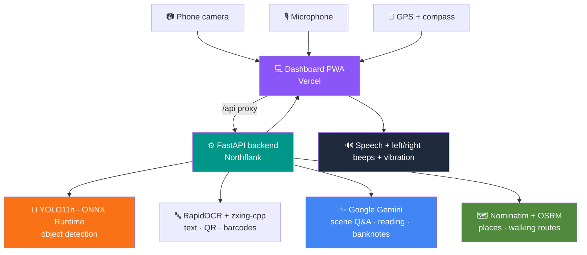
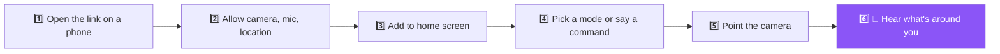

<div align="center">


<br>


<br>


</div>
<div align="center">

</div>

<div align="center">


[](https://eyedentify-dashboard.vercel.app)
[](https://eyedentify-dashboard.vercel.app/api/health)

</div>
<br>

> EYEDENTIFY ONE is Team Percevia's pair of AI smart glasses for blind and low-vision users. This repository is its **companion dashboard**: while the glasses hardware is offline, the **phone's camera, speaker and microphone stand in for the glasses**, and a cloud backend runs the AI. Point the phone, and EYEDENTIFY speaks what is ahead and how far away it is, reads signs and labels aloud, explains UPI QR codes and banknotes, guides walks turn by turn, and answers spoken questions about the scene, all with a voice-first, screen-reader-friendly interface.

<div align="center">

</div>

<div align="center">

</div>



**Key rule:** frames are analysed and then discarded. Nothing from the camera is stored, and the dashboard keeps its history only in the browser.

<div align="center">

</div>

<div align="center">

</div>

| Mode | What it does | Powered by |
|---|---|---|
| 🎯 **Real-time detection** | Speaks people, vehicles and obstacles with distance ("Person ahead, about 2 metres"), beeps in the ear they are closest to, vibrates when close. Demo hazard scenes for stairs, kerbs and platform edges | YOLO11n (320 px) on ONNX Runtime |
| 📖 **Instant reading** | Reads signs, labels, menus and pages aloud at 1.0–3.5× speed, and translates into Hindi | Gemini, with RapidOCR as fallback |
| 💳 **Payment & currency** | Scans UPI QR codes and speaks payee, UPI ID, app and amount; identifies Indian banknotes; change calculator | zxing-cpp · Gemini |
| 🧭 **AI navigation** | Where am I, place search, spoken turn-by-turn walking guidance with re-routing, clock-face "where is it", indoor metro demo | OpenStreetMap · Nominatim · OSRM · Leaflet |
| 💬 **Talk AI** | Ask anything about the scene by voice or text, in English or हिन्दी | Gemini |

**Voice commands from any page** (top-bar mic or `V`): *read this · where am I · take me to … · check this note · scan QR · detection mode · repeat · stop · help*. Anything else becomes a Talk AI question.

<div align="center">

</div>

<div align="center">

</div>

| | Glasses only | EYEDENTIFY dashboard |
|---|:---:|:---:|
| Works without the hardware | ❌ | ✅ any phone with Chrome |
| Detection round trip | — | ⚡ ~0.2–0.7 s per frame |
| Model updates | Reflash device | Push to `main`, auto-deploys |
| Install | Pairing + app | 🔗 Open a link, add to home screen |

Detection started on-device, but on mid-range phones it was slow and unreliable, so we moved to a **pre-trained YOLO11n exported to ONNX** running on the cloud. The 320 px export with a single thread keeps it fast even on a 0.2 vCPU free-tier container. Gemini requests are **hedged across several models**: a second model starts if the first is slow, and errors fall through to the next, so answers usually arrive in 2–6 s.

<div align="center">

</div>

<div align="center">

</div>

<div align="center">

**Team Name: Percevia**

| 👤 Member | ✉️ Email | 🛠️ Role |
|:---:|:---:|:---:|
| Tanish Aggarwal | tanishaggarwal.in@gmail.com | AI & Development |
| _Add member_ | | |
| _Add member_ | | |
| _Add member_ | | |

</div>

<div align="center">

</div>

<div align="center">

</div>

```bash
git clone https://github.com/TanishAggarwall/eyedentify-dashboard.git
cd eyedentify-dashboard
```

### 🔧 Backend + dashboard (one server)
```bash
python -m venv .venv
.venv\Scripts\pip install -r backend/requirements.txt
.venv\Scripts\pip install --no-deps -r backend/requirements-nodeps.txt
.venv\Scripts\python -m uvicorn app:app --app-dir backend --port 8080
```

Put `GEMINI_API_KEY=...` in `backend/.env` (git-ignored) to turn on the AI features; without it, Talk AI gives scripted demo answers. Open **http://localhost:8080** in Chrome. The same server serves the dashboard and the API.

> 💡 Phones only allow the camera and microphone on **HTTPS**, so test on a phone with the deployed address, not your laptop's local IP.

### ☁️ Deploy
- **Backend:** the `Dockerfile` builds the FastAPI service for **Northflank** (CI/CD from `main`). Set `GEMINI_API_KEY` as a secret and `ORT_THREADS=1`. See [`DEPLOY.md`](DEPLOY.md).
- **Frontend:** **Vercel** serves `public/` and proxies `/api/*` to the Northflank backend through [`vercel.json`](vercel.json). No build step.

<div align="center">

</div>

<div align="center">

</div>

| Endpoint | Input | Output |
|---|---|---|
| `GET /api/health` | — | Model, classes, AI status |
| `POST /api/detect` | JPEG body | YOLO boxes (normalised), labels, scores |
| `POST /api/read` | JPEG body | OCR text and lines |
| `POST /api/scan` | JPEG body | QR / barcode contents |
| `POST /api/ai/ask` · `read` · `translate` · `banknote` | JSON (image as base64, question, language) | Short spoken-style answer |
| `GET /api/nav/search` · `reverse` · `route` | Query / coordinates | Places, "you are on…", walking steps |

<div align="center">

</div>

<div align="center">

</div>

| Level | Trigger | Cue |
|---|---|:---:|
| 🟢 Clear | Nothing within the warning range | Silent |
| 🟡 Ahead | Object detected within range | Spoken name + distance, 1 beep |
| 🟠 Near | Object getting closer | Repeat alert, 2 beeps on that side |
| 🔴 Close | Object very close / hazard scene | Red box, 3 high beeps, vibration |

<div align="center">

</div>

<div align="center">

</div>

```text
backend/
  app.py          FastAPI app: API routes, serves public/
  detector.py     YOLO11n on ONNX Runtime: letterbox, inference, NMS
  ai.py           Gemini: Talk AI, reading, translation, banknotes (hedged requests)
  nav.py          Nominatim search / reverse, OSRM walking routes → spoken steps
  reader.py       RapidOCR text reading, zxing-cpp QR / barcodes
  models/         yolo11n-320.onnx (default), yolo11n.onnx (640 px)
public/
  index.html      Overview, five modes, Device & settings, History
  styles.css      Dark theme, large-text and high-contrast variants
  js/             app, detection, reading, payment, navigation, talk, voice,
                  speech, camera, api, store, modes
Dockerfile        Northflank container
vercel.json       Vercel static hosting + /api proxy
TESTING.md        Phone test checklist
```

**Keyboard (temple controls):** `Space` next mode · `1–5` jump to a mode · `V` voice command · `R` repeat · `Esc` stop speaking · `C` camera on/off

<div align="center">

</div>



<div align="center">

</div>
