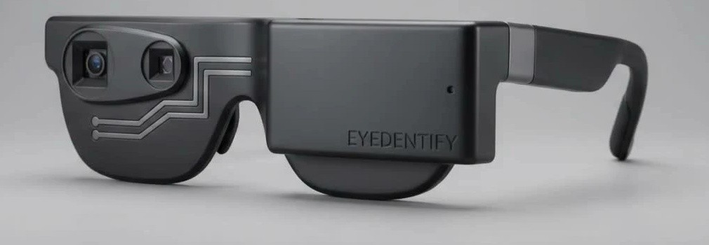
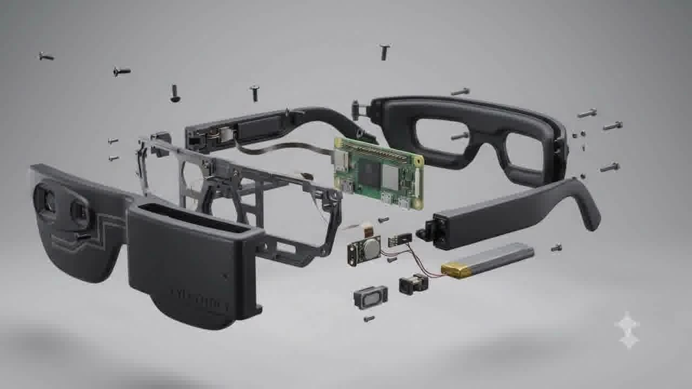
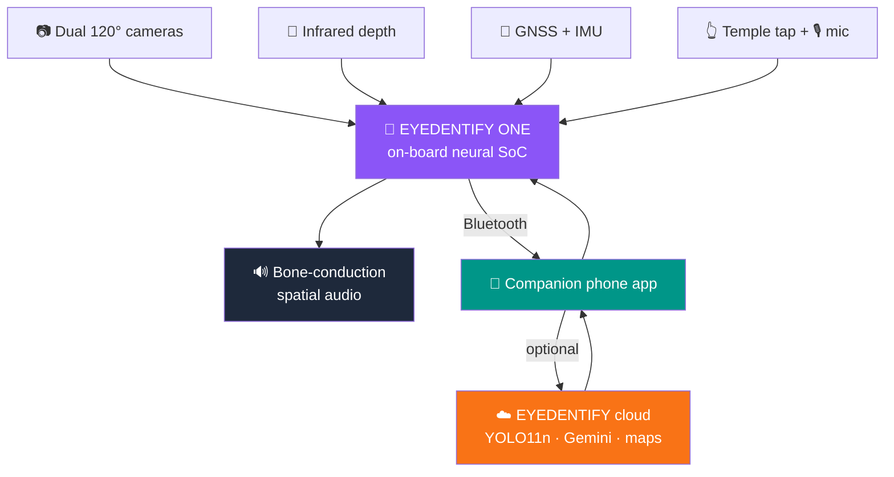
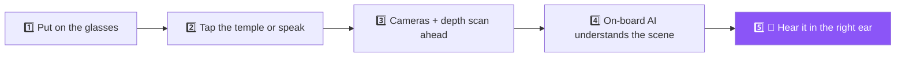

<div align="center">


<br>


<br>


<br><br>



<sub><i>EYEDENTIFY ONE · concept render</i></sub>

</div>

<div align="center">

</div>

> **EYEDENTIFY ONE** is a pair of AI smart glasses for blind and low-vision people, built by **Team Goal Digger** for [**NexHack 2.0**](https://unstop.com/hackathons/nexhack-20-geeta-university-naultha-panipat-1733198) at Geeta University, Naultha, Panipat. Dual wide-angle cameras and infrared depth sensing see the world in front of the wearer; an on-board neural processor recognises obstacles, text, money and places; and **bone-conduction spatial audio** speaks it into the ear it's closest to, leaving the ears free for traffic and conversation. The wearer switches between five assistive modes with a **tap on the temple** or a **voice command**, with no screen needed.

<div align="center">

</div>

<div align="center">




<sub><i>Exploded view: frame, camera module, compute board, dual battery and temple arms</i></sub>

</div>

| Component | Purpose |
|---|---|
| 📷 **Dual 120° HDR cameras** | Wide field of view for obstacles, text and faces |
| 🔦 **Infrared depth sensor** | Distance to obstacles; catches stairs, kerbs and drop-offs |
| 🧠 **Local neural SoC** | On-device detection, OCR and a vision-language model, so it works offline |
| 🔊 **Bone-conduction speakers** | Spatial audio cues in the left or right ear, ears stay open |
| 📍 **GNSS + visual-inertial odometry** | Outdoor position and heading; spatial beacons indoors |
| 👆 **Temple touch + microphone** | Tap to switch mode, speak to command or ask |
| 🔋 **Dual battery** | Up to 16 hours of use |
| 🛡️ **Grade 5 titanium frame, IP68** | 42 g, weather sealed for everyday wear |

**Why two cameras plus depth?** One camera can tell *what* is ahead; it can't reliably tell *how far*. The stereo pair and infrared depth give real distances, which is what turns "chair" into "chair, one metre, slightly left."

<div align="center">

</div>

<div align="center">

</div>



**Key rule:** safety alerts never wait on the network. Obstacle warnings come from the glasses themselves; the cloud only adds richer answers (scene questions, translation, routes) when a connection is available. Camera frames are analysed and discarded, never stored.

<div align="center">

</div>

<div align="center">

</div>

| Mode | What the wearer hears | Sensors used |
|---|---|---|
| 🎯 **Real-time detection** | "Person ahead, about 2 metres", with a beep in the ear it's closest to, faster as it gets nearer. Alerts for stairs, kerbs and obstacles | Cameras + infrared depth |
| 📖 **Instant reading** | Signs, labels, menus and pages read aloud at 1.0–3.5× speed; translation into other languages | Cameras + OCR |
| 💳 **Payment & currency** | Banknote values, and who a UPI QR code pays: name, UPI ID, app, amount | Cameras |
| 🧭 **AI navigation** | Turn-by-turn walking directions, "where am I", and clock-face directions ("the exit is at 2 o'clock") indoors and out | GNSS + IMU + beacons |
| 💬 **Talk AI** | Answers to "what's in front of me?" or "where did I put my keys?", in English or हिन्दी | Cameras + mic |

**Controls:** tap the temple to cycle modes · say *read this · where am I · take me to … · check this note · scan QR · repeat · stop*.

<div align="center">

</div>

<div align="center">

</div>

| Level | Trigger | Cue in the ear |
|---|---|:---:|
| 🟢 Clear | Nothing within the warning range | Silent |
| 🟡 Ahead | Object detected within range | Spoken name + distance, 1 beep |
| 🟠 Near | Object getting closer | Repeat alert, 2 beeps on that side |
| 🔴 Close | Object very close, or a drop / stair edge | 3 high beeps + vibration |

<div align="center">

</div>

<div align="center">

</div>

| Edition | Price | For |
|---|:---:|---|
| **Pioneer Edition** | ₹5,000 · ₹1,000 refundable deposit | Students and early adopters |
| **Pro + Care** | ₹6,500 · ₹1,500 refundable deposit | Prescription inserts, priority support |
| **Healthcare & Grants** | ₹0 out of pocket | Eligible veterans, rehab clients, NGO and insurance-supported users |

30-day trial after delivery · deposits refundable before shipping.

<div align="center">

</div>

<div align="center">

</div>

<div align="center">

**Team Name: Goal Digger**

[](https://unstop.com/hackathons/nexhack-20-geeta-university-naultha-panipat-1733198)

| 👤 Member |
|:---:|
| Manan Garg |
| Tanish Aggarwal |
| Yash Goel |
| Piyush Gupta |

</div>

<div align="center">

</div>

<div align="center">


[](https://eyedentify-dashboard.vercel.app)

</div>

This repository holds the **EYEDENTIFY companion dashboard and cloud backend**. For the live demo, the **phone acts as the glasses**: its camera stands in for the glasses' cameras, its speaker and stereo beeps stand in for bone conduction, and its microphone takes the voice commands. Every one of the five modes runs end to end, so judges can try the experience before the frames ship.

| Glasses part | Stand-in for the demo |
|---|---|
| Dual 120° cameras | Phone back camera |
| On-board neural SoC | Cloud backend: YOLO11n (ONNX Runtime), RapidOCR, zxing-cpp, Gemini |
| Infrared depth | Distance estimated from box size; demo hazard scenes for stairs and kerbs |
| Bone-conduction audio | Phone speech + left/right panned beeps (use earphones) |
| GNSS + IMU | Phone GPS and compass; OpenStreetMap routes |
| Temple tap | Mode button, `Space` key, or top-bar mic |

<details>
<summary><b>🔧 Run the dashboard locally</b></summary>

```bash
git clone https://github.com/TanishAggarwall/eyedentify-dashboard.git
cd eyedentify-dashboard
python -m venv .venv
.venv\Scripts\pip install -r backend/requirements.txt
.venv\Scripts\pip install --no-deps -r backend/requirements-nodeps.txt
.venv\Scripts\python -m uvicorn app:app --app-dir backend --port 8080
```

Put `GEMINI_API_KEY=...` in `backend/.env` (git-ignored) to turn on the AI features. Open **http://localhost:8080** in Chrome. Phones only allow the camera and microphone on **HTTPS**, so test on a phone with the deployed address.

**Deploy:** the `Dockerfile` runs the backend on **Northflank** (see [`DEPLOY.md`](DEPLOY.md)); **Vercel** serves `public/` and proxies `/api/*` to it via [`vercel.json`](vercel.json). Phone test checklist: [`TESTING.md`](TESTING.md).

</details>

<details>
<summary><b>🔌 Backend API</b></summary>

| Endpoint | Input | Output |
|---|---|---|
| `GET /api/health` | — | Model, classes, AI status |
| `POST /api/detect` | JPEG body | YOLO boxes (normalised), labels, scores |
| `POST /api/read` | JPEG body | OCR text and lines |
| `POST /api/scan` | JPEG body | QR / barcode contents |
| `POST /api/ai/ask` · `read` · `translate` · `banknote` | JSON (image as base64, question, language) | Short spoken-style answer |
| `GET /api/nav/search` · `reverse` · `route` | Query / coordinates | Places, "you are on…", walking steps |

</details>

<details>
<summary><b>📁 Project structure</b></summary>

```text
backend/
  app.py          FastAPI app: API routes, serves public/
  detector.py     YOLO11n on ONNX Runtime: letterbox, inference, NMS
  ai.py           Gemini: Talk AI, reading, translation, banknotes (hedged requests)
  nav.py          Nominatim search / reverse, OSRM walking routes → spoken steps
  reader.py       RapidOCR text reading, zxing-cpp QR / barcodes
  models/         yolo11n-320.onnx (default), yolo11n.onnx (640 px)
public/           Dashboard: Overview, five modes, Device & settings, History
docs/             Product images
Dockerfile        Northflank container
vercel.json       Vercel static hosting + /api proxy
```

**Keyboard (temple controls):** `Space` next mode · `1–5` jump to a mode · `V` voice command · `R` repeat · `Esc` stop speaking · `C` camera on/off

</details>

<div align="center">

</div>



<div align="center">

</div>
