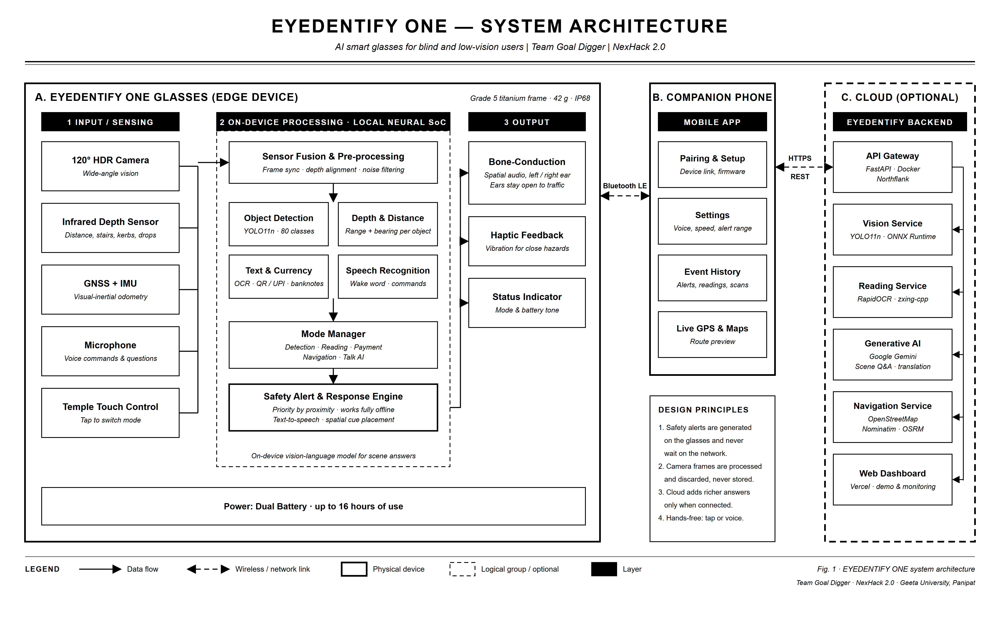
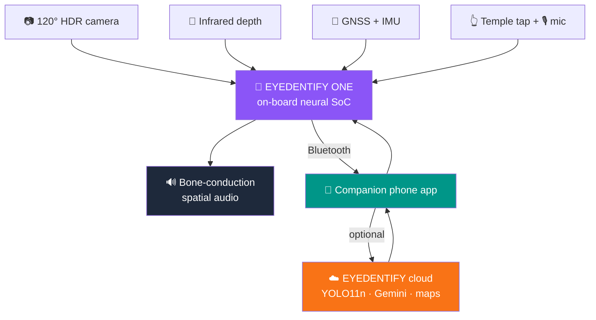

<div align="center">


<br>

[](https://github.com/TanishAggarwall/eyedentify-dashboard/actions/workflows/tests.yml)


<br>


<br><br>


<sub><i>EYEDENTIFY · concept render</i></sub>

</div>

<div align="center">

</div>

> **EYEDENTIFY ONE** is a pair of AI smart glasses for blind and low-visionary people, built by **Team Goal Digger** for [**NexHack 2.0**](https://unstop.com/hackathons/nexhack-20-geeta-university-naultha-panipat-1733198) at Geeta University, Naultha, Panipat. A wide-angle camera and infrared depth sensing see the world in front of the wearer; an on-board neural processor recognises obstacles, text, money and places; and **bone-conduction spatial audio** speaks it into the ear it's closest to, leaving the ears free for traffic and conversation. The wearer switches between five assistive modes with a **tap on the temple** or a **voice command**, with no screen needed.

<div align="center">

</div>

<div align="center">


<sub><i>Exploded view: frame, camera module, compute board, dual battery and temple arms</i></sub>

</div>

| Component | Purpose |
|---|---|
| 📷 **120° HDR camera** | Wide field of view for obstacles, text and faces |
| 🔦 **Infrared depth sensor** | Distance to obstacles; catches stairs, kerbs and drop-offs |
| 🧠 **Local neural SoC** | On-device detection, OCR and a vision-language model, so it works offline |
| 🔊 **Bone-conduction speakers** | Spatial audio cues in the left or right ear, ears stay open |
| 📍 **GNSS + visual-inertial odometry** | Outdoor position and heading; spatial beacons indoors |
| 👆 **Temple touch + microphone** | Tap to switch mode, speak to command or ask |
| 🔋 **Dual battery** | Up to 16 hours of use |
| 🛡️ **Grade 5 titanium frame, IP68** | 42 g, weather sealed for everyday wear |

**Why a camera plus depth?** A camera alone can tell *what* is ahead; it can't reliably tell *how far*. Pairing it with the infrared depth sensor gives real distances, which is what turns "chair" into "chair, one metre, slightly left."

<div align="center">

</div>

<div align="center">




<sub><i>Fig. 1 · EYEDENTIFY ONE system architecture</i></sub>
</div>



**Key rule:** safety alerts never wait on the network. Obstacle warnings come from the glasses themselves; the cloud only adds richer answers (scene questions, translation, routes) when a connection is available. Camera frames are analysed and discarded, never stored.

<div align="center">

</div>

<div align="center">

</div>

| Mode | What the wearer hears | Sensors used |
|---|---|---|
| 🎯 **Real-time detection** | "Person ahead, about 2 metres", with a beep in the ear it's closest to, faster as it gets nearer. Alerts for stairs, kerbs and obstacles | Camera + infrared depth |
| 📖 **Instant reading** | Signs, labels, menus and pages read aloud at 1.0–3.5× speed; translation into 8 Indian languages and English | Camera + OCR |
| 💳 **Payment & currency** | Banknote values, and who a UPI QR code pays: name, UPI ID, app, amount | Camera |
| 🧭 **AI navigation** | Turn-by-turn walking directions, "where am I", and clock-face directions ("the exit is at 2 o'clock") indoors and out | GNSS + IMU + beacons |
| 💬 **Talk AI** | Answers to "what's in front of me?" or "where did I put my keys?", in English or हिन्दी | Camera + mic |

**Controls:** tap the temple to cycle modes · say *read this · where am I · take me to … · check this note · scan QR · repeat · stop*.

<div align="center">

</div>

Every feature above is implemented in this repository. This table points to the code, the API endpoint and the automated tests for each one.

| Feature | Code | API endpoint | Tests |
|---|---|---|---|
| 🎯 **Real-time obstacle detection** | [`backend/detector.py`](backend/detector.py) (YOLO11n on ONNX Runtime, 80 object classes, NMS) · [`public/js/detection.js`](public/js/detection.js) (distance and direction estimate, spoken alerts, left/right beeps, vibration) | `POST /api/detect` | [`test_api.py`](backend/tests/test_api.py) `test_detect_returns_normalised_boxes` · [`test_units.py`](backend/tests/test_units.py) `test_nms_*` |
| 📖 **Text reading (OCR)** | [`backend/reader.py`](backend/reader.py) `read_text` (RapidOCR) · [`backend/ai.py`](backend/ai.py) `read` (Gemini, falls back to OCR) · [`public/js/reading.js`](public/js/reading.js) | `POST /api/read` · `POST /api/ai/read` | `test_read_finds_printed_text` · `test_ai_read_falls_back_to_ocr_without_a_key` · `test_tidy_ocr_text` |
| 🌐 **Translation** | [`backend/ai.py`](backend/ai.py) `translate` · language picker in [`public/index.html`](public/index.html) (Hindi, Tamil, Telugu, Bengali, Marathi, Kannada, Gujarati, Punjabi, English) | `POST /api/ai/translate` | — (calls Gemini, not run in CI) |
| 💳 **Payment: UPI / QR codes** | [`backend/reader.py`](backend/reader.py) `scan_codes` (zxing-cpp) · [`public/js/payment-logic.js`](public/js/payment-logic.js) `parseCode` (payee, UPI ID, app, amount, scam warnings) · [`public/js/payment.js`](public/js/payment.js) | `POST /api/scan` | `test_scan_decodes_a_upi_qr_code` · [`frontend.test.mjs`](tests/frontend.test.mjs) UPI tests |
| 💵 **Currency: banknotes and change** | [`backend/ai.py`](backend/ai.py) `banknotes` (Indian ₹10–₹500 notes) · [`public/js/payment-logic.js`](public/js/payment-logic.js) `breakdown`, `rupees` (change in notes and coins) | `POST /api/ai/banknote` | [`frontend.test.mjs`](tests/frontend.test.mjs) `breakdown`, `rupees` tests |
| 🧭 **AI navigation** | [`backend/nav.py`](backend/nav.py) (Nominatim place search, where-am-I, OSRM walking routes turned into spoken steps) · [`public/js/navigation.js`](public/js/navigation.js) (map, turn-by-turn speech, re-routing, clock-face directions, indoor metro walk-through) | `GET /api/nav/search` · `/api/nav/reverse` · `/api/nav/route` | `test_instruction_wording` · `test_route_folds_short_unnamed_steps` · `test_navigation_*` |
| 💬 **Talk AI** | [`backend/ai.py`](backend/ai.py) `ask` · [`public/js/talk.js`](public/js/talk.js) (voice or text, English / हिन्दी) | `POST /api/ai/ask` | `test_talk_ai_uses_demo_answer_without_a_key` |
| 📱 **Phone as the camera** | [`public/js/remote.js`](public/js/remote.js) (laptop: pairing QR, receive video) · [`public/phone.html`](public/phone.html) + [`public/js/phone.js`](public/js/phone.js) (phone: stream camera) · [`backend/remote.py`](backend/remote.py) (signalling + frame relay) | `/api/remote/*` · `GET /api/qr` | [`test_remote.py`](backend/tests/test_remote.py) |
| 🎙️ **Voice commands** | [`public/js/commands.js`](public/js/commands.js) `parseCommand` · [`public/js/voice.js`](public/js/voice.js) | — (runs in the browser) | [`frontend.test.mjs`](tests/frontend.test.mjs) voice tests |

**Prototype scope, stated plainly:**
- **Stairs, kerbs and drop-offs:** the glasses detect these with the infrared depth sensor. The phone prototype has no depth sensor and YOLO's 80 everyday classes don't include stairs, so the dashboard plays these alerts as labelled **demo hazard scenes**.
- **Indoor navigation:** shown as a step-by-step metro walk-through. Real indoor positioning needs the glasses' spatial beacons.
- **Card terminals:** planned for the glasses. The prototype reads UPI QR codes and banknotes.

<div align="center">

</div>

<div align="center">

</div>

| Level | Trigger | Cue in the ear |
|---|---|:---:|
| 🟢 Clear | Nothing within the warning range | Silent |
| 🟡 Ahead | Object detected within range | Spoken name + distance, 1 beep |
| 🟠 Near | Object getting closer | Repeat alert, 2 beeps on that side |
| 🔴 Close | Object very close, or a drop / stair edge | 3 high beeps + vibration |

<div align="center">

</div>

<div align="center">

</div>

| Edition | Price | For |
|---|:---:|---|
| **Pioneer Edition** | ₹5,000 · ₹1,000 refundable deposit | Students and early adopters |
| **Pro + Care** | ₹6,500 · ₹1,500 refundable deposit | Prescription inserts, priority support |
| **Healthcare & Grants** | ₹0 out of pocket | Eligible veterans, rehab clients, NGO and insurance-supported users |

30-day trial after delivery · deposits refundable before shipping.

<div align="center">

</div>

<div align="center">

</div>

<div align="center">

**Team Name: Goal Digger**

[](https://unstop.com/hackathons/nexhack-20-geeta-university-naultha-panipat-1733198)

| 👤 Member |
|:---:|
| Manan Garg |
| Tanish Aggarwal |
| Yash Goel |
| Piyush Gupta |

</div>

<div align="center">

</div>

<div align="center">


[](https://eyedentify-dashboard.vercel.app)

</div>

This repository holds the **EYEDENTIFY companion dashboard and cloud backend**. For the live demo, the **phone acts as the glasses**: its camera stands in for the glasses' camera, its speaker and stereo beeps stand in for bone conduction, and its microphone takes the voice commands. Every one of the five modes runs end to end, so judges can try the experience before the frames ship.

| Glasses part | Stand-in for the demo |
|---|---|
| 120° HDR camera | Phone back camera |
| On-board neural SoC | Cloud backend: YOLO11n (ONNX Runtime), RapidOCR, zxing-cpp, Gemini |
| Infrared depth | Distance estimated from box size; demo hazard scenes for stairs and kerbs |
| Bone-conduction audio | Phone speech + left/right panned beeps (use earphones) |
| GNSS + IMU | Phone GPS and compass; OpenStreetMap routes |
| Temple tap | Mode button, `Space` key, or top-bar mic |

**Run it on a laptop with your phone as the camera.** Open the dashboard on the laptop and pick **Phone** in the *Your camera* card. Scan the QR code with the phone and tap **Start streaming**. The phone's video goes straight to the laptop over WebRTC; if the network blocks that, frames are relayed through the server instead. If the phone disconnects, the dashboard **switches back to the laptop webcam automatically** (about 8–13 s), and the **Webcam / Phone** switch changes source at any time.

<details>
<summary><b>🔧 Run the dashboard locally</b></summary>

```bash
git clone https://github.com/TanishAggarwall/eyedentify-dashboard.git
cd eyedentify-dashboard
python -m venv .venv
.venv\Scripts\pip install -r backend/requirements.txt
.venv\Scripts\pip install --no-deps -r backend/requirements-nodeps.txt
.venv\Scripts\python -m uvicorn app:app --app-dir backend --port 8080
```

Put `GEMINI_API_KEY=...` in `backend/.env` (git-ignored) to turn on the AI features. Open **http://localhost:8080** in Chrome. Phones only allow the camera and microphone on **HTTPS**, so test on a phone with the deployed address.

**Deploy:** the `Dockerfile` runs the backend on **Northflank** (see [`DEPLOY.md`](DEPLOY.md)); **Vercel** serves `public/` and proxies `/api/*` to it via [`vercel.json`](vercel.json). Phone test checklist: [`TESTING.md`](TESTING.md).

</details>

<details>
<summary><b>🧪 Tests</b></summary>

101 automated tests run on every push to `main` through GitHub Actions ([`tests.yml`](.github/workflows/tests.yml)).

| Suite | Tests | Covers |
|---|:---:|---|
| **Backend API** · [`backend/tests/test_api.py`](backend/tests/test_api.py) | 20 | YOLO detection returns valid normalised boxes, a generated UPI QR code is decoded, printed text is read by OCR, Talk AI and AI reading fall back safely without a Gemini key, bad / empty / oversized uploads are rejected, out-of-range coordinates and 25 km+ walks are refused |
| **Phone-as-camera pairing** · [`backend/tests/test_remote.py`](backend/tests/test_remote.py) | 20 | Pairing codes, WebRTC offer/answer signalling, JPEG frame relay (newest frame only, size and type checks), session expiry, QR link |
| **Backend units** · [`backend/tests/test_units.py`](backend/tests/test_units.py) | 30 | Spoken walking instructions, route step folding (OSRM mocked), distance maths, OCR text clean-up, non-max suppression, demo answers |
| **Frontend** · [`tests/frontend.test.mjs`](tests/frontend.test.mjs) | 31 | UPI QR parsing (payee, app, amount, scam warnings), rupee formatting, change in notes and coins, voice command parsing |

Tests never call Gemini or any paid API.

```bash
.venv\Scripts\pip install -r backend/requirements-dev.txt
cd backend && ..\.venv\Scripts\python -m pytest      # backend
node --test tests/*.test.mjs                           # frontend (Node 22+)
```

</details>

<details>
<summary><b>🔌 Backend API</b></summary>

| Endpoint | Input | Output |
|---|---|---|
| `GET /api/health` | — | Model, classes, AI status |
| `POST /api/detect` | JPEG body | YOLO boxes (normalised), labels, scores |
| `POST /api/read` | JPEG body | OCR text and lines |
| `POST /api/scan` | JPEG body | QR / barcode contents |
| `POST /api/ai/ask` · `read` · `translate` · `banknote` | JSON (image as base64, question, language) | Short spoken-style answer |
| `GET /api/nav/search` · `reverse` · `route` | Query / coordinates | Places, "you are on…", walking steps |

</details>

<details>
<summary><b>📁 Project structure</b></summary>

```text
backend/
  app.py          FastAPI app: API routes, serves public/
  detector.py     YOLO11n on ONNX Runtime: letterbox, inference, NMS
  ai.py           Gemini: Talk AI, reading, translation, banknotes (hedged requests)
  nav.py          Nominatim search / reverse, OSRM walking routes → spoken steps
  reader.py       RapidOCR text reading, zxing-cpp QR / barcodes
  models/         yolo11n-320.onnx (default), yolo11n.onnx (640 px)
public/           Dashboard: Overview, five modes, Device & settings, History
  js/payment-logic.js, js/commands.js   browser-free logic (unit-tested)
backend/tests/    pytest suite
tests/            frontend unit tests (node --test)
.github/workflows CI: runs all tests on every push
docs/             Product images
Dockerfile        Northflank container
vercel.json       Vercel static hosting + /api proxy
```

**Keyboard (temple controls):** `Space` next mode · `1–5` jump to a mode · `V` voice command · `R` repeat · `Esc` stop speaking · `C` camera on/off

</details>

<div align="center">

</div>


<div align="center">

</div>
